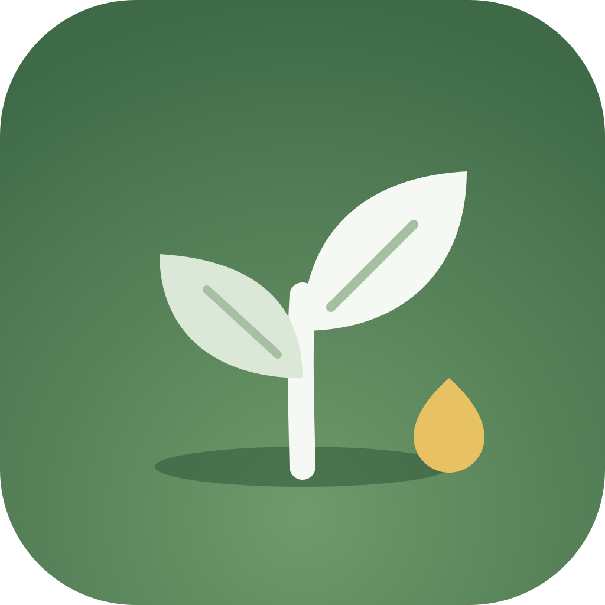

<div align="center">



# Tend

**A gentle reminder app for brains that find starting hard.**<br />
Tiny steps, small immediate rewards, and a tree that grows and never wilts.<br />
Built for Windows and Android, designed with AuDHD in mind.

<br />

[](https://github.com/CheersLoveDani/tend/releases/latest)
[](https://github.com/CheersLoveDani/tend/actions/workflows/release.yml)
[](https://github.com/CheersLoveDani/tend/releases)

[](https://github.com/CheersLoveDani/tend/releases/latest)
[](https://github.com/CheersLoveDani/tend/releases/latest)
[](https://tauri.app)
[](https://www.rust-lang.org)
[](https://react.dev)
[](https://www.typescriptlang.org)
[](plugins/tauri-plugin-tend-native)


<br />

<a href="https://github.com/CheersLoveDani/tend/releases/latest"></a>
&nbsp;
<a href="https://github.com/CheersLoveDani/tend/releases/latest"></a>

<sub>Install once. After that, Tend updates itself.</sub>

</div>

---

## 🌱 Why Tend

Most to-do apps are built for people who already find it easy to start. Tend is
built for the other moment: when the task is clear, but starting isn't. It
breaks things into tiny steps, rewards each one straight away, keeps what's
waiting gently visible, and never punishes a missed day. Nothing resets and
nothing wilts.

The design choices come from research on ADHD, autism and executive function:
see [docs/AUDHD_RESEARCH.md](docs/AUDHD_RESEARCH.md).

## ✨ Features

### ✅ Reminders that meet you where you are
- **Today or any day.** Optional times, and repeats daily, on weekdays, weekly
  or monthly. Type it naturally ("call the dentist tomorrow at 10") and Tend
  picks up the day and time.
- **Tiny steps, paid as you go.** Each step pays seeds the moment you tick it,
  straight from the card. No steps? There's an "I did a bit" button.
- **Nothing piles up.** Things from earlier days fold into one row with *Bring
  into today* or *Let them rest* (Someday). Any task moves with one menu, and
  repeating habits keep rolling forward even when a day is missed.
- **Stormy days count too.** Check in with your inner weather. On a stormy day,
  Tend can offer to keep just one thing and move the rest to tomorrow. Only if
  you want it.

### 🌳 Rewards that feel good, not guilty
- **Seeds, levels and a growing tree** through ten stages, from a seed to a
  grove. Optional surprise golden seeds for finishing things.
- **Natural reward sounds:** woodblock for steps, a marimba run with wind chimes
  for finishing, a bird for bonuses. Synthesised live, so there are no audio
  files, and each one can be muted.
- **Calm by design:** a reduce-motion setting, light and dark themes, and no
  streaks to lose.

### 🔔 Nudges that stay gentle
- **Pick a style when you start:** Quiet, Gentle or Persistent.
- A timed reminder nudges at its time and once more, then waits quietly. An
  hourly chime covers only what's actually due, never old untimed chores.
- **Quiet for today** silences everything except medicine. Quiet hours, sound,
  vibrate or silent cues, and heads-ups before timed reminders are all yours to
  set.

### 💊 Medicine, without the nagging tone
- Add what you take with its shape, colour, dose and schedule: every day, every
  few days, some weekdays, on/off cycles, or when needed.
- Due doses come first everywhere and keep reminding until they're taken or
  skipped. Taking one earns seeds (a little extra when it's on time), and an
  honest skip still earns a quarter.
- Counts what's left and warns before you run out, and keeps a health diary of
  mood, symptoms and readings like blood pressure.

### 🚶 Movement grows the tree too <sub>(Android)</sub>
- Reads steps and workouts from **Health Connect**, where Google Fit, Samsung
  Health, Fitbit and most fitness apps keep them.
- Set your own daily step and exercise goals and what they're worth. Bars on
  Today fill up, then glow gold as you overflow past the goal.
- A reminder can be a workout ("Run, 20 min") that ticks itself off when your
  phone logs it.

### 📅 Your calendar alongside <sub>(Android)</sub>
- Events from calendars synced to your phone, Google Calendar included, show on
  Today and Coming up. Read-only, and nothing leaves the phone.

### 🧠 A tiny model that runs on your device
- Suggests a seed value and ready-made tiny steps as you type, from your own
  past breakdowns or a library of 170 ADHD-friendly ones.
- It learns your scale: your own values count 11 times as much as the built-in
  ones. It asks before downloading, and works without it too.

## 📱 Platform extras

<table>
<tr>
<th width="50%">🤖 Android</th>
<th width="50%">🪟 Windows</th>
</tr>
<tr valign="top">
<td>

- A quiet **"still to do" notification** you can type a new task into, tick a
  step from, or quiet for the day
- Exact alarms with **Done · 1 h · Tomorrow**
- **Home-screen widget**, **Quick Settings tile**, launcher shortcuts and
  **Share to Tend**
- A **"before you dive in" screen** on unlock: swipe right when done, left for
  tomorrow, or switch on buttons instead
- Home-screen and unlock screen work even when the app isn't open

</td>
<td>

- Lives in the **tray**, which lists today's things (click one to finish it)
- **Ctrl + Alt + Space** opens quick add from anywhere
- Fires due reminders as Windows notifications
- Can start with Windows, quietly

</td>
</tr>
</table>

### 🔄 Sync, backups and updates
- **Sync over your Wi-Fi.** Pair your phone and computer by scanning a QR code
  or typing a 6-digit code. Edits merge last-writer-wins, and the seed history
  is append-only, so totals always agree. Nothing goes to any cloud.
- **Encrypted daily backups** to a file you choose (Google Drive works) or a
  folder, protected by a passphrase only you know.
- **Updates itself** from this repository's releases, and always asks before
  installing.

---

<details>
<summary><b>🧠 How the on-device model works</b></summary>

<br />

Tend uses **bge-micro**, a 17M-parameter embedding model (a 35 MB download).

- Each time you type a task, it loads (memory-mapped), compares the task with
  ~215 built-in tasks and your own past reminders, and unloads. That takes
  about 25 ms on a desktop. The arm64 build takes 150–190 ms under ARM
  translation on an x86 emulator, so a real phone should be faster.
- It suggests a seed value. You can nudge it up or down, and your own values
  count 11 times as much as the built-in ones, so it learns your scale.
- It offers ready-made tiny steps, either from your own earlier breakdowns or
  from a library of 170 ADHD-friendly breakdowns, added with one tap.
- Exact repeats reuse your last value. If the model isn't downloaded or is
  switched off, a keyword estimate is used instead.

</details>

<details>
<summary><b>🔋 Battery</b></summary>

<br />

- Nothing on the phone polls.
- Alarms use `AlarmManager`: one chime alarm at a time, only while something is
  due, skipping quiet hours and "Quiet for today".
- The unlock screen is a sleeping foreground service. It holds a single
  `USER_PRESENT` receiver, with no threads, timers or wakelocks, and stops as
  soon as nothing is waiting.
- Health Connect and the calendar are read only while Tend is open.
- The model runs for about 25 ms only while the editor is asking for a
  suggestion, and then it's dropped from memory.
- The sound engine suspends after 4 seconds of silence.
- The phone syncs when you open or return to the app and after each change. It
  doesn't sync in the background.

</details>

<details>
<summary><b>📲 First run on Android</b></summary>

<br />

1. Pick how gentle you want the nudges, and allow notifications when asked.
2. If something Tend needs isn't allowed yet (on-time alarms, showing over other
   apps for the unlock screen, background running on aggressive OEM skins),
   **Settings** shows a *Fix* banner with one tap for each.
3. In **Settings → Sync between devices**, tap *Scan QR code* and point the
   camera at the code in the desktop app's Settings. Typing the address and
   code works too. If Windows asks about the firewall, allow private networks.
4. Optional: add the **Tend widget** to your home screen and the **Tend tile**
   to Quick Settings.

</details>

<details>
<summary><b>🛠️ Building</b></summary>

<br />

Requirements: Node 20+, Rust stable, and for Android: SDK, NDK 27 and JDK 17+.

```sh
npm install
npm run tauri dev                    # desktop, hot reload
npm run dev                          # UI only, in a browser, with a mock backend
npm run tauri build                  # Windows installer (src-tauri/target/release/bundle)

# Android (NDK_HOME must point at the versioned NDK folder)
export NDK_HOME="$ANDROID_HOME/ndk/27.2.12479018"
npm run tauri android build -- --apk --target aarch64
```

The browser preview fakes the native parts so every screen can be checked:
`?nag` opens the unlock screen, `?steps=9100&mins=45` fakes Health Connect,
`?cal` fakes calendar events, and `?welcome` shows onboarding.

Local release APKs are signed with the key named in
`src-tauri/gen/android/keystore.properties` (not committed). Without that file
they fall back to the debug key, which is fine for testing but cannot update an
installed official release.

</details>

<details>
<summary><b>🚀 Releasing</b></summary>

<br />

1. Bump the version in `package.json`, `src-tauri/tauri.conf.json` and
   `src-tauri/Cargo.toml`, and add a `CHANGES` entry in
   `src/components/WhatsNew.tsx` for the in-app "what changed" note.
2. Commit, then tag and push: `git tag v0.3.0 && git push origin v0.3.0`.
3. The **Release** workflow builds the Windows installer (with a signed
   `latest.json` for the updater) and the Android APK, and attaches them to the
   GitHub release. Installed copies pick the release up on their next check.
4. Watch it live with `pwsh scripts/watch-release.ps1 v0.3.0`.

The workflow needs these repository secrets:

| Secret | What |
| --- | --- |
| `TAURI_SIGNING_PRIVATE_KEY` | Updater signing key (its public half is in `tauri.conf.json`) |
| `ANDROID_KEYSTORE_BASE64` | The release keystore, base64-encoded |
| `ANDROID_KEYSTORE_PASSWORD` | Its password |

Keep the private keys safe: if either is lost, installed copies can no longer
update and need a manual reinstall.

</details>

<details>
<summary><b>🗂️ Project layout</b></summary>

<br />

| Path | What |
| --- | --- |
| `src/` | React UI: views, components, sound engine, store |
| `src-tauri/src/` | Rust backend: SQLite (`db.rs`), rewards and reminder logic (`rewards.rs`, `actions.rs`), medicine (`meds.rs`), movement (`fitness.rs`), LAN sync (`sync.rs`), backups (`backup.rs`), tray, quick add and scheduler (`desktop.rs`), suggestions (`suggest.rs`) |
| `crates/tend-llm/` | Tiny on-device model (candle + bge-micro embeddings): reward and step suggestions, with a heuristic fallback |
| `plugins/tauri-plugin-tend-native/` | Android plugin: alarms, notifications, unlock screen, widget, Quick Settings tile, share target, Health Connect, calendar |
| `scripts/watch-release.ps1` | Live progress card for a release build |
| `docs/AUDHD_RESEARCH.md` | Research notes and the design principles they led to |

</details>

---

<div align="center">

### 📜 Licence

Copyright © 2026 Dani Fullerton. All rights reserved.<br />
The source is public to read, but it is **not open source**: see [LICENSE](LICENSE).

<sub>Made with care for brains that work differently. 🌱</sub>

</div>
